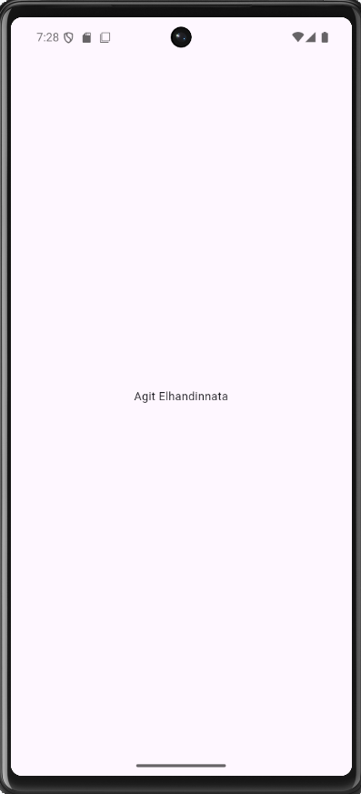
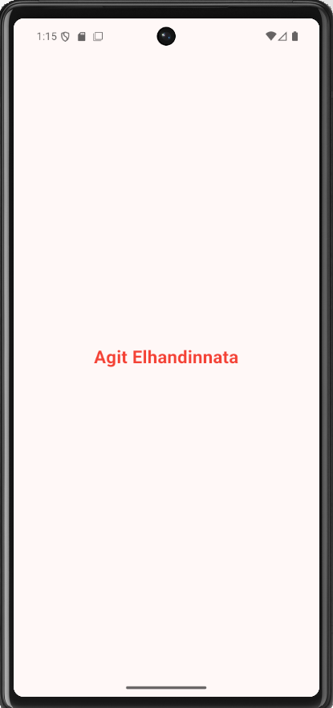

# task_week4

latihan 1 - identitas aplikasi. 

disini saya telah berhasil mengubah nama apliakasi menjadi "Aplikasi Mahasiwa" 
dan sudah mengubah teks ditengah menjadi nama saya sendiri 

## Screenshot Aplikasi

latihan 2- tema warna

disiini saya telah berhasil nengubah warna pada text 'agit elhandinnata' menjadi warna merah
menggunnakan textStyle

